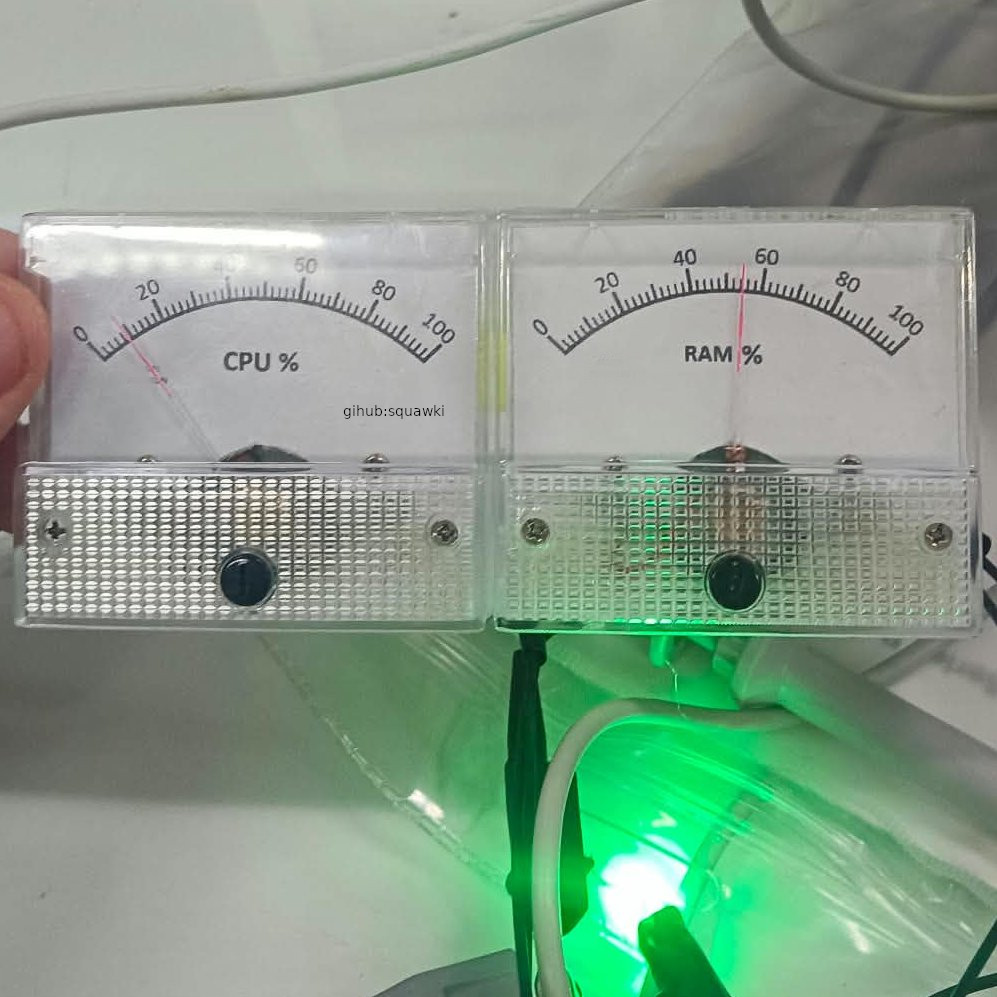
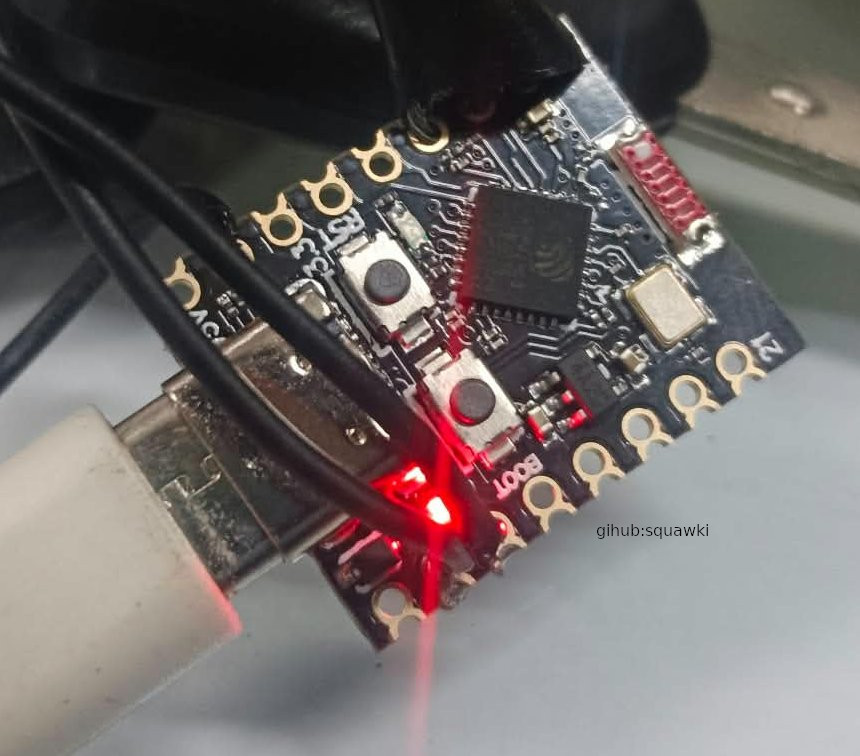
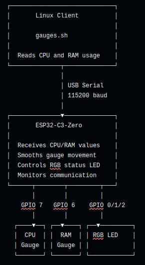
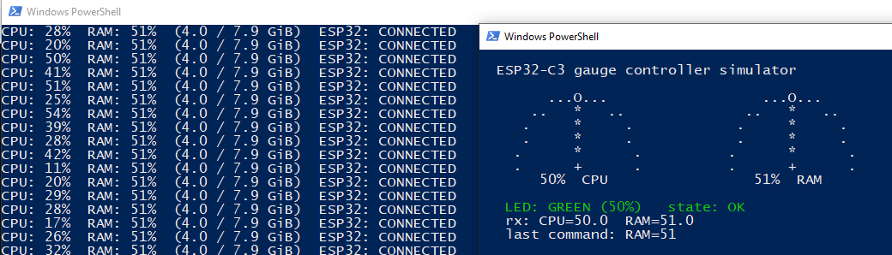

# CPU & RAM Gauges - Powered by ESP32-C3
A physical CPU and RAM monitor for a Linux computer or server, built around an ESP32-C3-Zero and two analogue moving-coil gauges.

The server sends CPU and physical memory usage over USB to the ESP32, which converts the values into smooth movements of the two gauges. An RGB LED provides a visual status indicator, with the ESP32 firmware also supporting manual colours, brightness control and an automatic status mode.

The project is intentionally simple. Rather than displaying another set of numbers on a screen, it provides a physical, always-visible indication of server activity. The gauges respond gradually to changes in system load, while a communication failure causes both gauges to enter a visible fault sweep and the RGB LED to turn red.

The Linux side monitors CPU and RAM, and can optionally watch internet connectivity and blink the LED while the connection is down. The ESP32 firmware provides the LED control commands the server script uses for this.
<br>



## Features

- Real-time CPU utilisation gauge
- Real-time physical RAM utilisation gauge
- USB serial communication between the Linux server and ESP32
- Smooth gauge movement rather than abrupt changes
- Adjustable gauge response and smoothing
- Automatic communication failure detection
- Fault mode with an alternating gauge sweep when communication is lost
- RGB LED status indication
- Automatic LED status mode:
  - Blue while waiting for telemetry
  - Green during normal communication
  - Red when communication is lost
- Manual RGB colour control through the ESP32 serial interface
- Adjustable LED brightness
- Separate LED on/off and brightness controls
- Optional internet outage detection with a configurable LED blink alert
- Windows support through a PowerShell port
- Simulators for Linux and Windows, for testing without hardware
- ESP32 acknowledgement of received CPU and RAM values
- Runs as a systemd service on the Linux server
- No network connection required between the server and ESP32
- Uses standard Linux `/proc` system information for CPU and memory usage
- Custom printable gauge face and backplate template included
## Hardware Required

### Main components

| Component | Quantity | Notes |
|---|---:|---|
| ESP32-C3-Zero | 1 | Waveshare ESP32-C3-Zero used for this project |
| ZHFU 85C1 analogue gauge | 2 | 1 mA DC moving-coil panel meter |
| 2 kΩ resistor | 2 | One resistor in series with each gauge |
| Common-cathode RGB LED | 1 | Used for system status indication |
| 200Ω Current-limiting resistors | 3 | One resistor for each RGB LED channel |
| USB cable | 1 | Connects the ESP32 to the Linux/Proxmox server |
| Hook-up wire | As required | 28 AWG is suitable for the gauge wiring |

### Optional / construction materials

- Printed gauge faceplates
- Printed backplate or mounting template
- Panel or enclosure for mounting the gauges and ESP32
- Connectors or terminal blocks as required
- Suitable mounting hardware

### Gauge specification

The gauges used in this build are:

**ZHFU 85C1 (1 milli amp)**

- DC moving-coil analogue meter
- 64 × 56 × 52 mm
- 1 mA range

The original gauge was replaced with a custom faceplate to show CPU/RAM instead, the scale was not changed.

The 2 kΩ series resistors limit the current supplied by the ESP32 GPIO pins and allow the gauge movement to be driven safely using PWM.

## How It Works

The project is split into two parts: a Linux server component and an ESP32 firmware component.



### Linux Server

`gauges.sh` runs on the Linux or Proxmox server and periodically reads system statistics from the Linux `/proc` filesystem.

CPU utilisation is calculated from the CPU counters in `/proc/stat`.

Physical memory utilisation is calculated from `/proc/meminfo` using:

```text
Used memory = MemTotal - MemAvailable
```

Swap is not included in the RAM percentage.

The resulting values are sent to the ESP32 over the USB serial connection:

```text
CPU=42
RAM=68
```

The server sends updated values once per second.

Optionally, the script can also monitor internet connectivity and use the LED as an outage alarm. This is disabled by default; see [Internet Outage Detection](#internet-outage-detection-optional).

### ESP32

The ESP32 receives the telemetry and converts the 0 to 100% values into PWM output for the two analogue gauges.

The gauges are connected to:

- **GPIO 7:** CPU gauge
- **GPIO 6:** RAM gauge

The gauges are updated independently and use software smoothing so that their movement resembles a physical instrument rather than immediately jumping between values.

The ESP32 also controls a common-cathode RGB LED:

- **GPIO 0:** Red
- **GPIO 1:** Green
- **GPIO 2:** Blue
- **Common cathode:** ESP32 GND

Each RGB LED channel uses its own current-limiting resistor.

The ESP32 sends acknowledgements back to the server:

```text
ACK CPU=42.0
ACK RAM=68.0
```

These acknowledgements allow the Linux script to determine whether communication with the ESP32 is working.

### Communication Failure

The ESP32 monitors the time since the last valid CPU or RAM message.

If no valid telemetry is received for 3 seconds, the ESP32 considers communication to have failed.

It then:

1. Enters fault mode.
2. Moves the CPU and RAM gauges in opposite directions through a continuous sweep.
3. Forces the RGB LED to solid red at full brightness.
4. Reports the communication failure over serial.

When telemetry is received again, the fault mode is cleared and the gauges return to normal operation.

This means the physical panel can indicate a server or USB communication problem even when the server is no longer able to update the gauges.

This fault is about the USB link between the server and the ESP32. An internet outage on the server is a different condition: the gauges keep working normally, and the optional [internet outage detection](#internet-outage-detection-optional) reports it by blinking the LED instead.

## Installation and Setup

### 1. Flash the ESP32

Open the ESP32 firmware in the Arduino IDE.

Select the appropriate ESP32-C3 board and connect the ESP32-C3-Zero over USB.

The firmware uses:

- **CPU frequency:** 40 MHz
- **Flash frequency:** 80 MHz
- **USB:** Serial communication
- **Baud rate:** 115200

Upload the firmware to the ESP32.

After uploading, open the Serial Monitor at **115200 baud** to verify that the controller starts correctly.

### 2. Connect the ESP32 to the Server

Connect the ESP32 to the Linux or Proxmox server using USB.

The ESP32 should appear as a serial device, normally:

```text
/dev/ttyACM0
```

Check the available serial devices with:

```bash
ls /dev/ttyACM*
```

If a different device name is assigned, update the `SERIAL_PORT` setting in `gauges.sh`.

### 3. Install the Linux Script

Copy `gauges.sh` to the desired location on the server:

```text
/scripts/gauges.sh
```

Make the script executable:

```bash
sudo chmod +x /scripts/gauges.sh
```

The script reads CPU and memory information from `/proc` and sends the values to the ESP32 once per second.

Run it manually first to confirm that the gauges respond correctly:

```bash
sudo /scripts/gauges.sh
```

The script displays the current CPU and RAM values along with the serial communication status.

Press `Ctrl+C` to stop the script.

### 4. Install the systemd Service

Copy the included service file to:

```text
/etc/systemd/system/gauges.service
```

Then reload systemd:

```bash
sudo systemctl daemon-reload
```

Enable the service so it starts automatically with the server:

```bash
sudo systemctl enable gauges.service
```

Start it:

```bash
sudo systemctl start gauges.service
```

Check the service status:

```bash
sudo systemctl status gauges.service
```

The gauges should now update automatically whenever the server is running.

To use the LED as an internet outage alarm as well, set `INTERNET_CHECK_ENABLED=1` in `/scripts/gauges.sh` before starting the service. See [Internet Outage Detection](#internet-outage-detection-optional).

### 5. Useful Service Commands

Restart the service:

```bash
sudo systemctl restart gauges.service
```

Stop the service:

```bash
sudo systemctl stop gauges.service
```

Disable automatic startup:

```bash
sudo systemctl disable gauges.service
```

Once installed, the ESP32 can remain connected to the server and operate without any additional software or network connection.

## Windows

`windows/gauges.ps1` is a PowerShell port of `linux/gauges.sh`. It sends the same commands to the same firmware, so nothing needs to change on the ESP32 side.

### Requirements

- Windows 10 or 11 with PowerShell 5.1 (built in) or PowerShell 7
- The ESP32 connected by USB. Windows 10 and 11 normally install the USB CDC driver automatically and the board appears as `COMx`.

### Running the script

Find the port name with:

```powershell
[System.IO.Ports.SerialPort]::GetPortNames()
```

Then run the script:

```powershell
.\gauges.ps1 -Port COM3
```

If `-Port` is omitted the first available serial port is used.

Internet outage detection works exactly as it does on Linux:

```powershell
.\gauges.ps1 -Port COM3 -InternetCheck -PingTarget 1.1.1.1
```

`-CheckInterval` and `-BlinkInterval` override the timing values in the settings block at the top of the script. Windows has no journald, so pass `-LogFile` to record outages and recoveries:

```powershell
.\gauges.ps1 -Port COM3 -InternetCheck -LogFile C:\ProgramData\esp32-gauges\gauges.log
```

CPU utilisation comes from `Win32_PerfFormattedData_PerfOS_Processor` and memory from `Win32_PerfFormattedData_PerfOS_Memory` (`AvailableMBytes`), which matches the Linux script's use of `MemAvailable` rather than plain free memory.

### Running as a service

Windows has no systemd. Either use Task Scheduler with a task that runs at startup:

```text
powershell.exe -NoProfile -ExecutionPolicy Bypass -File C:\scripts\gauges.ps1 -Port COM3 -InternetCheck -LogFile C:\ProgramData\esp32-gauges\gauges.log
```

or install the script as a service with [NSSM](https://nssm.cc/):

```text
nssm install ESP32Gauges "C:\Program Files\PowerShell\7\pwsh.exe" "-NoProfile -File C:\scripts\gauges.ps1 -Port COM3"
nssm set ESP32Gauges AppRestartDelay 5000
```

`-ExecutionPolicy Bypass` on the command line avoids changing the machine-wide execution policy.

### Simulator

The sender can be run against a simulator instead of the ESP32, so the whole path can be exercised without hardware. See [Simulator](#simulator) below.

## Simulator

The sender can run against a simulator instead of the ESP32, so the whole path can be exercised before the board is wired up. A fake ESP32 is provided for both platforms:

```text
simulator/
├── linux/
│   ├── simulator.py     # the fake ESP32, over a pseudo-terminal
│   └── simulate.sh      # starts the simulator and linux/gauges.sh together
└── windows/
    ├── simulator.ps1    # the fake ESP32, over TCP or a serial port
    └── simulate.ps1     # starts both
```

The senders live in [`linux/gauges.sh`](linux/gauges.sh) and [`windows/gauges.ps1`](windows/gauges.ps1). Full guides are in [simulator/README.md](simulator/README.md).

### Linux

Requirements: `bash` and `python3` (standard library only). No drivers, no `socat`, no hardware.

```bash
./simulator/linux/simulate.sh
```

The simulator creates a pseudo-terminal and the launcher runs the gauge script against it by setting the `DEVICE` environment variable. In a terminal the dials are drawn in place; the sender's status lines go to a log that is printed when you stop with `Ctrl+C`:

```text
Simulator device: /dev/pts/1

        .......                  .......
      ...      ..              ...      ..
     .O*         .            .         *O.
     . **        .            .        ** .
    .    **       .          .       **    .
    .      +      .          .      +      .
       28%  CPU                 38%  RAM

   LED: GREEN (50%)   state: OK
   rx: CPU=28.0  RAM=38.0
   last command: RAM=38
```

`--no-ui` (or running with output redirected) prints one status line per second instead. To keep the dials and watch the sender's own output at the same time, run the halves in two terminals:

```bash
./simulator/linux/simulator.py            # prints: Device: /dev/pts/7
DEVICE=/dev/pts/7 ./linux/gauges.sh
```

Because the pseudo-terminal is a real tty, the serial code path (`stty`, `exec 3<>`) is exercised rather than bypassed.

| Option | Default | Meaning |
|---|---|---|
| `--device PATH` | none | Attach to an existing tty/pty instead of creating one |
| `--write-device-file PATH` | none | Write the device path to this file |
| `--no-ui` | off | One status line per second instead of the dials |
| `--no-color` | off | Do not colour the LED line |
| `--preview N` | none | Draw one frame at N percent and exit |
| `--duration SECONDS` | `0` (forever) | Stop after this many seconds |
| `--fault-timeout SECONDS` | `3` | Silence before `SIGNAL LOST` and the fault sweep |

### Windows

Requirements: Windows 10 or 11 with PowerShell 5.1 (built in) or PowerShell 7.

```powershell
.\simulator\windows\simulate.ps1
```

The launcher opens the simulator in its own console window, waits for it, then runs `windows/gauges.ps1 -Simulate` against it over TCP on `127.0.0.1:7777`, so no virtual serial driver is needed. The three scripts can also be copied into a single folder anywhere: the launcher looks for `gauges.ps1` next to itself before falling back to `..\..\windows\gauges.ps1`.

```powershell
.\simulator\windows\simulate.ps1 -Duration 60
.\simulator\windows\simulate.ps1 -NoUi
.\simulator\windows\simulate.ps1 -InternetCheck -PingTarget 192.0.2.1 -CheckInterval 10 -BlinkInterval 8
.\simulator\windows\simulator.ps1 -Preview 42
```

| Option (simulate.ps1) | Default | Meaning |
|---|---|---|
| `-TcpPort` | `7777` | Port shared by the simulator and the sender |
| `-Source` | `Auto` | `Auto` reports this machine's real CPU and memory; `Random` invents values on a pretend 32 GiB machine |
| `-NoUi` | off | Headless simulator, log printed at the end |
| `-Duration` | `0` (forever) | Stop after this many seconds |
| `-InternetCheck` | off | Enable outage detection so the purple blink can be watched |
| `-PingTarget`, `-CheckInterval`, `-BlinkInterval` | script defaults | Passed through to the sender |
| `-GaugesPath` | sibling, then `..\..\windows\gauges.ps1` | Where to find the sender |
| `-KeepSimulatorOpen` | off | Leave the simulator window open after the sender exits |

| Option (simulator.ps1) | Default | Meaning |
|---|---|---|
| `-TcpPort` | `7777` | Listen for one TCP client |
| `-Port` | none | Use a real or virtual serial port instead, for example `COM11` |
| `-Baud` | `115200` | Serial baud rate |
| `-NoUi` | off | One status line per second instead of the dials |
| `-Preview` | none | Draw one frame at the given percentage and exit |
| `-Duration` | `0` (forever) | Stop after this many seconds |



### What it reproduces

- `CPU=n` and `RAM=n`, clamped to `0..100`, with `ACK CPU=xx.x` / `ACK RAM=xx.x`
- Every `LED=` command the firmware accepts — `AUTO`, `ON`, `OFF`, `DIM,n`, the seven named colours and `RGB,r,g,b` — with the matching `ACK LED=...` and `ERROR:` replies
- The 3 second communication timeout: `SIGNAL LOST`, the LED forced to red at full brightness and the needles sweeping until telemetry returns (`SIGNAL RESTORED`)
- Dimming to the configured brightness after the first telemetry message, and brightness being kept when the colour changes
- The last CPU and RAM values received, shown under the dials so a mismatch with the sender is visible

It does not reproduce the 500 Hz PWM, the gauge smoothing (the needles move instantly) or the printed gauge faces.

### Watching the outage blink

Point the sender at an address that cannot answer so the outage path triggers straight away. On Windows:

```powershell
.\simulator\windows\simulate.ps1 -InternetCheck -PingTarget 192.0.2.1 -CheckInterval 10 -BlinkInterval 8
```

On Linux, set `PING_TARGET` and shorten `CHECK_INTERVAL` / `BLINK_INTERVAL` in `gauges.sh`, then run the simulator and the sender as shown above.

The LED turns purple, blinks five times, returns to green and repeats every interval.

### Troubleshooting

- **`404: Not Found` when running a script** — the file is a saved GitHub error page; re-download it or clone the repository.
- **"running scripts are disabled on this system"** — use `powershell -ExecutionPolicy Bypass -File .\simulator\windows\simulate.ps1`.
- **"Could not connect to the simulator at 127.0.0.1:7777"** — the simulator is not running, or another program owns the port; pass `-TcpPort 7778` to both halves.
- **Dials do not appear** — the panel needs a real terminal; use a normal console window, or the headless mode (`-NoUi` / `--no-ui`).
- **Needles never move** — the sender is not connected; check for `ESP32: CONNECTED` in its output.

## LED Control

The ESP32 firmware supports several serial commands for controlling the RGB status LED.

These commands can be sent directly over the USB serial connection and can also be integrated into `gauges.sh` in the future.

### Automatic Status Mode

The automatic mode changes the LED colour based on the current communication state:

```text
LED=AUTO
```

The LED indicates:

| State | Colour |
|---|---|
| Waiting for telemetry | Blue |
| Normal communication | Green |
| Communication lost | Red |

Communication failure always takes priority over manual LED settings and forces the LED to solid red at full brightness.

### Manual Colours

The firmware includes several predefined colours:

```text
LED=RED
LED=GREEN
LED=BLUE
LED=YELLOW
LED=CYAN
LED=MAGENTA
LED=WHITE
```

An arbitrary RGB colour can also be selected:

```text
LED=RGB,255,128,0
```

RGB values range from `0` to `255`.

### Brightness

LED brightness can be adjusted independently of the selected colour:

```text
LED=DIM,50
```

The value represents a percentage from `0` to `100`.

For example:

```text
LED=DIM,25
```

sets the LED to 25% brightness.

### LED On and Off

The LED can be disabled without changing the currently selected colour or brightness:

```text
LED=OFF
```

It can then be restored with:

```text
LED=ON
```

### LED Integration

By default `gauges.sh` only sends CPU and RAM telemetry and leaves the LED in automatic mode.

When [internet outage detection](#internet-outage-detection-optional) is enabled the script also sends LED commands: it blinks a configurable colour while the internet is unreachable and returns to `LED=AUTO` afterwards.

The rest of the LED command interface remains available for other server events without changing the ESP32 protocol.

## Internet Outage Detection (Optional)

`gauges.sh` can watch internet connectivity and use the RGB LED as an outage alarm. The feature is disabled by default. Enable it by setting `INTERNET_CHECK_ENABLED=1` in the configuration block at the top of the script and restarting the service.

```bash
INTERNET_CHECK_ENABLED=1
```

### How It Works

Every `CHECK_INTERVAL` seconds (default 60) the script pings `PING_TARGET` (default `1.1.1.1`).

The first ping is always attempted. A retry is only made if the previous attempt failed, up to `PING_ATTEMPTS` attempts in total (default 3). Each attempt waits `PING_TIMEOUT` seconds (default 2) for a reply, so a failed check is confirmed in about six seconds.

If every attempt fails the internet is considered down and the LED blinks `BLINK_COUNT` times (default 5) using `LED_OUTAGE` (default `LED=RGB,255,0,255`, purple), switching between the colour and `LED=OFF` every `BLINK_STEP` seconds (default 0.25). After the last flash the LED returns to `LED_NORMAL` (default `LED=AUTO`), which is green while telemetry is flowing.

While the internet is down the blink repeats every `BLINK_INTERVAL` seconds (default 30). A fresh check runs before each blink, so a recovery is detected within one blink interval and the blinking stops.

Because `LED=RGB` keeps the LED's configured brightness (`LED=DIM`), the blink uses the same brightness as the normal green indicator.

### Settings

| Setting | Default | Description |
|---|---|---|
| `INTERNET_CHECK_ENABLED` | `0` | `0` disables the feature, `1` enables it |
| `PING_TARGET` | `1.1.1.1` | Address to ping. An IP is used so the check does not depend on DNS |
| `PING_ATTEMPTS` | `3` | Total attempts per check; a retry only happens after a failure |
| `PING_TIMEOUT` | `2` | Seconds to wait for each reply |
| `CHECK_INTERVAL` | `60` | Seconds between checks while the internet is up |
| `BLINK_INTERVAL` | `30` | Seconds between blink sequences while the internet is down |
| `BLINK_COUNT` | `5` | Flashes per blink sequence |
| `BLINK_STEP` | `0.25` | Seconds the LED stays on, and then off, during a blink |
| `LED_OUTAGE` | `LED=RGB,255,0,255` | Command used for the blink. Any LED command works, for example `LED=MAGENTA` |
| `LED_NORMAL` | `LED=AUTO` | Command sent after each blink to restore the normal colour |
| `CHECK_WATCHDOG` | `20` | Abandon a stuck check after this many seconds and assume the internet is up |

### Logging

Outages and recoveries are written to the system log, so they can be reviewed even though the service discards its standard output:

```bash
journalctl -t gauges
```

```text
Internet outage: no reply from 1.1.1.1 after 3 attempts
Internet restored (reply from 1.1.1.1)
```

When the script is run manually, the console also shows each blink:

```text
Internet DOWN: blinking 5x LED=RGB,255,0,255
```

### Notes

- The pings run in a background subshell and telemetry continues between blink steps, so the ESP32's 3 second communication timeout is never reached and the gauges do not enter the fault sweep.
- Detection uses ICMP echo. Networks that block or rate-limit ICMP will produce false alarms; choose a target your provider answers.
- `ping` must be installed. It is part of iputils on most Linux distributions.
- No firmware change or reflash is needed. The blink is produced with the LED commands the firmware already supports.

## Frequently Asked Questions

### Do all of the grounds need to be connected together?

Yes.

The ESP32, gauges and RGB LED need to share a common ground. The ESP32 GND is the reference for the gauge outputs and the RGB LED.

For example:

```text
ESP32 GND
   ├── CPU gauge
   ├── RAM gauge
   └── RGB LED common cathode
```

The USB connection to the server also provides the ESP32 ground reference.

### Can I use a different gauge?

Yes, provided the gauge is suitable for the way it is being driven.

The firmware uses PWM to control the current through the moving-coil gauges. If you use a different gauge, the series resistor and maximum PWM value may need to be changed.

Do not remove the series resistors simply because a different gauge does not reach full scale.

### How do I calibrate the gauge to 100%?

The gauge scale can be calibrated in the firmware using the maximum PWM percentage.

The relevant setting is:

```cpp
GAUGE_MAX_PERCENT = 66.0f;
```

This determines how much PWM is used when the reported CPU or RAM value reaches 100%.

If the gauge does not reach the desired 100% position, increase this value.

If it goes past the desired 100% position, decrease it.

This allows the physical gauge to be calibrated without changing the Linux script or the gauge face.

### Why does the gauge reach full scale before 100% PWM?

The gauge and series resistor determine how much current is required to reach full physical movement.

In this build, the gauge reaches its calibrated full-scale position at approximately 66% PWM rather than 100%.

This is intentional. The remaining PWM range is unused to keep the gauge within its intended operating range.

### Can I change the gauge response speed?

Yes.

The CPU and RAM gauges use separate smoothing periods in the ESP32 firmware.

This allows the gauges to respond quickly enough to show changes in server load while avoiding constant rapid movement.

If you want the gauges to react more quickly, reduce the smoothing time.

If you want slower and more stable movement, increase it.

### Why are the gauges not jumping immediately to the current value?

The gauges use software smoothing.

A physical moving-coil gauge naturally has some mechanical damping, so smoothing the incoming values makes the display look more like an analogue instrument and prevents rapid changes in CPU or RAM usage from causing excessive movement.

### Can I use a different ESP32 version or micro-controller

Yes, just update the board type in board manager and be mindful of the new pin layout for the board.
The C3 version was chosen for its small size, lower power and low price.

### What happens if the server stops sending data?

After 3 seconds without valid telemetry, the ESP32 enters communication fault mode.

The gauges perform an alternating sweep and the RGB LED turns solid red at full brightness.

When valid telemetry is received again, normal operation resumes.

### Does the ESP32 need Wi-Fi?

No.

The project uses USB serial communication between the Linux server and the ESP32.

No Wi-Fi, Bluetooth or network connection is required.

Internet outage detection runs on the server and tests the server's own connection; the ESP32 still needs no network of its own.


### Is swap included in the RAM gauge?

No.

The RAM percentage is based on physical memory:

```text
Used memory = MemTotal - MemAvailable
```

Swap usage is not included.

### What does the RGB LED indicate?

In automatic mode:

- **Blue:** Waiting for telemetry
- **Green:** Normal communication
- **Red:** Communication lost

A communication fault overrides the normal LED settings and forces the LED to solid red at full brightness.

### Can I control the RGB LED manually?

Yes.

The ESP32 supports predefined colours, arbitrary RGB values, brightness control, on/off control and automatic status mode.

See the [LED Control](#led-control) section for the available commands.

### Why doesn't the LED blink when my internet connection goes down?

Internet outage detection is disabled by default.

Set `INTERNET_CHECK_ENABLED=1` in the configuration block at the top of `gauges.sh`, adjust `PING_TARGET` if necessary and restart the service.

See [Internet Outage Detection](#internet-outage-detection-optional) for the available settings.

### Why does my ESP32 show a different serial device name?

Linux may assign a different device name depending on the system and USB configuration.

The default configuration uses:

```text
/dev/ttyACM0
```

Check which device was assigned with:

```bash
ls /dev/ttyACM*
```

If necessary, update the serial port in `gauges.sh`.

### Can I run the gauge wiring over a long cable?

Yes.

The gauge wiring in this build uses approximately 5 metres of cable.

28 AWG hook-up wire is suitable for this application. Longer cable runs for tens of meters may also work, although excessive cable length can introduce additional resistance and electrical noise.

### Do I need a capacitor across the gauges?

No.

The current build does not require additional capacitors on the gauge outputs.

The PWM signal is handled by the ESP32 and the moving-coil mechanism naturally averages the rapidly changing signal.

### Why is the PWM frequency 500 Hz?

The gauges are mechanical moving-coil instruments, so they respond to the average effect of the PWM signal rather than following each individual pulse.

A 500 Hz PWM frequency provides a suitable balance for this application while keeping the implementation simple.

### Can I remove the 2 kΩ gauge resistors?

No.

The 2 kΩ resistors are part of the gauge drive circuit and limit the current supplied by the ESP32 GPIO pins.

They should remain in series with the gauges.

### Can I change the GPIO pins?

Yes, but the firmware must be updated to match.

The current build uses:

```text
GPIO 7  -> CPU gauge
GPIO 6  -> RAM gauge

GPIO 1  -> Red LED
GPIO 2  -> Green LED
GPIO 0  -> Blue LED
```

Avoid using ESP32-C3 pins that are already required for USB, boot functions or onboard hardware unless you understand the consequences.

### Does the Linux script need to run continuously?

Yes.

`gauges.sh` is designed to run continuously and send updated CPU and RAM values to the ESP32 once per second.

The included systemd service keeps it running automatically and restarts it if it exits.

### Can I use the ESP32 without the Linux script?

Yes, for testing.

The ESP32 can be connected to a computer and controlled through its serial interface. This is also useful for testing the gauges and RGB LED independently of the Linux monitoring script.

### Can I use the project without the RGB LED?

Yes.

The gauges do not depend on the RGB LED for operation. The LED is a visual status indicator and can be omitted if desired.

### Can I use different resistors for the RGB LED?

Yes.

Each RGB LED channel should have its own appropriate current-limiting resistor.

The required value depends on the LED and desired current. Do not connect the RGB channels directly to the ESP32 GPIO pins without current limiting.
200-500ohm is a good starting part.

### Can I change the faceplate or gauge artwork?

Yes.

The gauge face is purely cosmetic and does not affect the electronics. Most gauges can be opened up pretty easily.

The included template can be modified or replaced with your own design. The important part is that the printed 0 to 100% scale matches the calibrated physical movement of the gauge, this will change for each printer/software/paper-size

### Will this work on Windows or [insert OS here]?

Yes for Windows: `windows/gauges.ps1` is a PowerShell port of the Linux script, with a simulator for testing without hardware. See the [Windows](#windows) section.

For other operating systems, the ESP32 does not care what the host is, it just receives serial data of what percentage to set the gauges and to change the LED. You will need to update the script accordingly or write an equivalent program.

### What happens if I change the gauge or resistor?

You will probably need to recalibrate `GAUGE_MAX_PERCENT`.

The Linux side still reports 0 to 100% and does not need to know anything about the physical gauge. The ESP32 firmware handles the conversion from the reported percentage to the appropriate PWM output.
