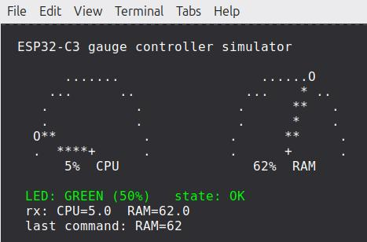
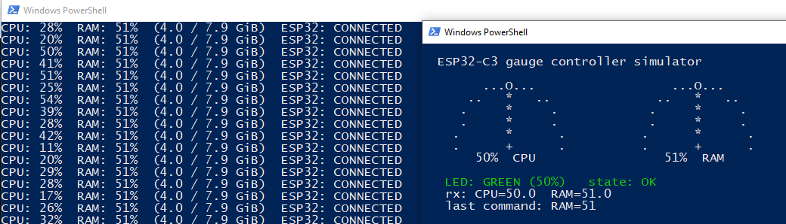

# Gauge simulator

A stand-in for the ESP32-C3 gauge controller, so the server side of the project can be built and tested without hardware.

The project has two halves: the server script that sends CPU and RAM values, and the ESP32 that drives the two gauges and the RGB LED. This directory contains a fake ESP32 for each platform that speaks the same serial protocol, answers with the same acknowledgements and behaves the same way when telemetry stops arriving.

```text
simulator/
├── linux/
│   ├── simulator.py     # the fake ESP32, over a pseudo-terminal
│   └── simulate.sh      # starts the simulator and linux/gauges.sh together
├── windows/
│   ├── simulator.ps1    # the fake ESP32, over TCP or a serial port
│   └── simulate.ps1     # starts both
└── images/simulator-windows.png
```

The senders live in [`../linux/gauges.sh`](../linux/gauges.sh) and [`../windows/gauges.ps1`](../windows/gauges.ps1).

## Linux

Requirements: `bash` and `python3` (standard library only). No hardware, no virtual serial driver, no `socat`.

### Quick start

```bash
./simulator/linux/simulate.sh
```

The simulator creates a pseudo-terminal and the launcher runs `linux/gauges.sh` against it by setting the `DEVICE` environment variable. In a terminal the dials are drawn in place; the sender's status lines are written to a log and printed when you stop with `Ctrl+C`:



Because the sender talks to a real pseudo-terminal, the serial code path (`stty`, `exec 3<>`) is exercised rather than bypassed.

### Headless and separate terminals

`--no-ui` (or running with output redirected) prints one status line per second instead of the dials:

```bash
./simulator/linux/simulate.sh --no-ui
```

To keep the dials and watch the sender's own output at the same time, run the halves in two terminals:

```bash
./simulator/linux/simulator.py
# Device: /dev/pts/7
# Attach the sender: DEVICE=/dev/pts/7 ./linux/gauges.sh

DEVICE=/dev/pts/7 ./linux/gauges.sh
```

### Options

| Option | Default | Meaning |
|---|---|---|
| `--device PATH` | none | Attach to an existing tty/pty instead of creating one |
| `--write-device-file PATH` | none | Write the device path to this file (used by `simulate.sh`) |
| `--no-ui` | off | One status line per second instead of the dials |
| `--no-color` | off | Do not colour the LED line |
| `--preview N` | none | Draw one frame at N percent and exit |
| `--duration SECONDS` | `0` (forever) | Stop after this many seconds |
| `--fault-timeout SECONDS` | `3` | Silence before `SIGNAL LOST` and the fault sweep |

Flags passed to `simulate.sh` are forwarded to the simulator:

```bash
./simulator/linux/simulate.sh --duration 60
./simulator/linux/simulate.sh --fault-timeout 2
```

## Windows

Requirements: Windows 10 or 11 with PowerShell 5.1 (built in) or PowerShell 7. No drivers are needed: the simulator and the sender talk over TCP on `127.0.0.1`.

```powershell
.\simulator\windows\simulate.ps1
```

The launcher opens the simulator in its own console window, waits for it, then runs `windows/gauges.ps1 -Simulate` against it. The three scripts can also be copied into a single folder anywhere, because the launcher looks for `gauges.ps1` next to itself before falling back to `..\..\windows\gauges.ps1`.

```powershell
.\simulator\windows\simulate.ps1 -Duration 60
.\simulator\windows\simulate.ps1 -NoUi
.\simulator\windows\simulate.ps1 -InternetCheck -PingTarget 192.0.2.1 -CheckInterval 10 -BlinkInterval 8
.\simulator\windows\simulator.ps1 -Preview 42
```

| Option (simulate.ps1) | Default | Meaning |
|---|---|---|
| `-TcpPort` | `7777` | Port shared by the simulator and the sender |
| `-Source` | `Auto` | `Auto` reports this machine's real CPU and memory; `Random` invents values on a pretend 32 GiB machine |
| `-NoUi` | off | Headless simulator, log printed at the end |
| `-Duration` | `0` (forever) | Stop after this many seconds |
| `-InternetCheck` | off | Enable outage detection so the purple blink can be watched |
| `-PingTarget`, `-CheckInterval`, `-BlinkInterval` | script defaults | Passed through to the sender |
| `-GaugesPath` | sibling, then `..\..\windows\gauges.ps1` | Where to find the sender |
| `-KeepSimulatorOpen` | off | Leave the simulator window open after the sender exits |

| Option (simulator.ps1) | Default | Meaning |
|---|---|---|
| `-TcpPort` | `7777` | Listen for one TCP client |
| `-Port` | none | Use a real or virtual serial port instead, for example `COM11` |
| `-Baud` | `115200` | Serial baud rate |
| `-NoUi` | off | One status line per second instead of the dials |
| `-Preview` | none | Draw one frame at the given percentage and exit |
| `-Duration` | `0` (forever) | Stop after this many seconds |



## What it reproduces

- `CPU=n` and `RAM=n`, clamped to `0..100`, with `ACK CPU=xx.x` / `ACK RAM=xx.x`
- Every `LED=` command the firmware accepts — `AUTO`, `ON`, `OFF`, `DIM,n`, the seven named colours and `RGB,r,g,b` — with the matching `ACK LED=...` and `ERROR:` replies
- The 3 second communication timeout: `SIGNAL LOST`, the LED forced to red at full brightness and the needles sweeping until telemetry returns (`SIGNAL RESTORED`)
- Dimming to the configured brightness after the first telemetry message, and brightness being kept when the colour changes
- The panel also shows the last CPU and RAM values received, so a mismatch between the sender and the dials is visible

It does not reproduce the 500 Hz PWM, the gauge smoothing (the needles move instantly) or the printed gauge faces.

## Watching the outage blink

Point the sender at an address that cannot answer, so the outage path triggers straight away.

On Linux, set `PING_TARGET` and shorten the intervals in `linux/gauges.sh`, then run:

```bash
DEVICE=/dev/pts/7 ./linux/gauges.sh
```

On Windows:

```powershell
.\simulator\windows\simulate.ps1 -InternetCheck -PingTarget 192.0.2.1 -CheckInterval 10 -BlinkInterval 8
```

The LED turns purple, blinks five times, returns to green and repeats every interval.

## Serial path

On Linux the pseudo-terminal *is* the serial path, so nothing extra is needed. On Windows, TCP bypasses the serial code; to test that as well, install a virtual null-modem pair such as [com0com](https://sourceforge.net/projects/com0com/) (`COM10` <-> `COM11`) and run the halves separately:

```powershell
.\simulator\windows\simulator.ps1 -Port COM11        # fake ESP32
.\windows\gauges.ps1 -Port COM10 -InternetCheck      # sender
```

## Troubleshooting

- **`404: Not Found` when running a script** — the file is a saved GitHub error page; re-download it or clone the repository.
- **"running scripts is disabled on this system"** — use `powershell -ExecutionPolicy Bypass -File .\simulator\windows\simulate.ps1`.
- **"Could not connect to the simulator at 127.0.0.1:7777"** — the simulator is not running, or another program owns the port; pass `-TcpPort 7778` to both halves.
- **Dials do not appear on Windows** — cursor positioning is unavailable in PowerShell ISE and redirected consoles; use a normal console window or `-NoUi`.
- **Dials do not appear on Linux** — the panel needs a terminal; without one the simulator prints a status line per second instead.
- **Needles never move** — the sender is not connected; check for `ESP32: CONNECTED` in its output.
- **`Permission denied` running `linux/gauges.sh`** — the launcher calls it with `bash`, but `chmod +x linux/gauges.sh` works too.

## Using the real device instead

With the ESP32 plugged in, the simulator is not needed:

```bash
sudo ./linux/gauges.sh
```

```powershell
.\windows\gauges.ps1 -Port COM3
```
